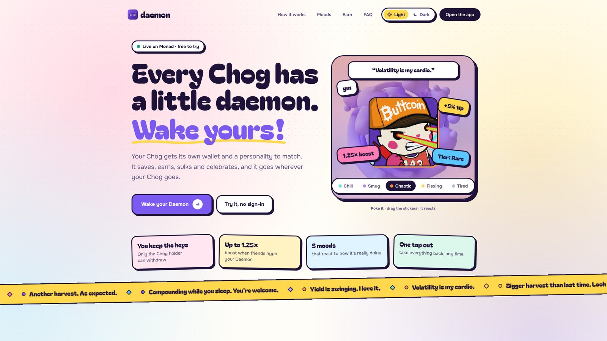
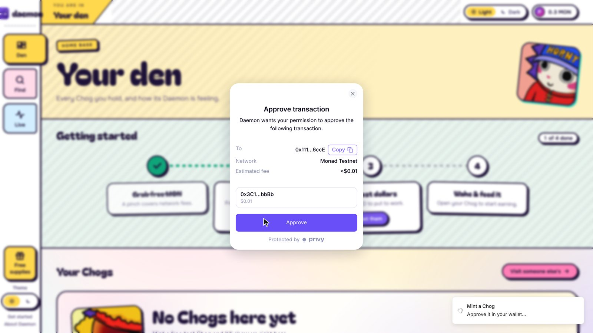
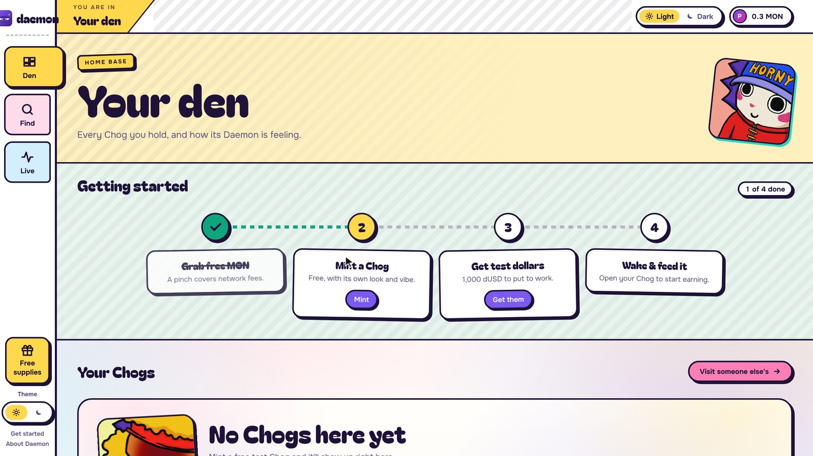
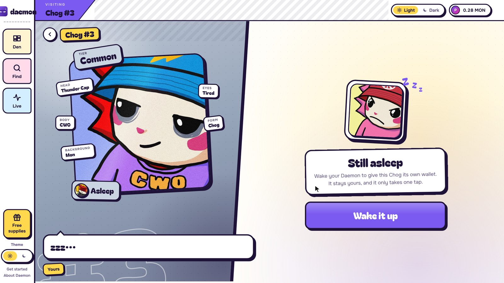
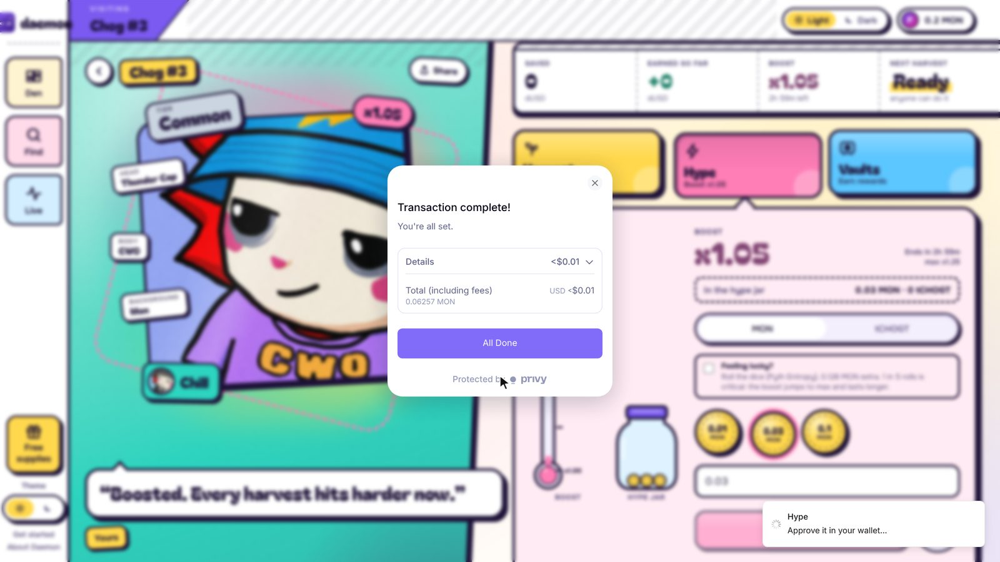
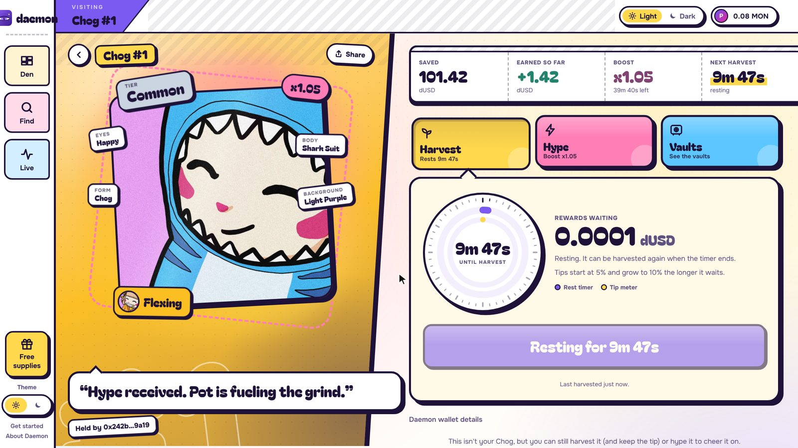
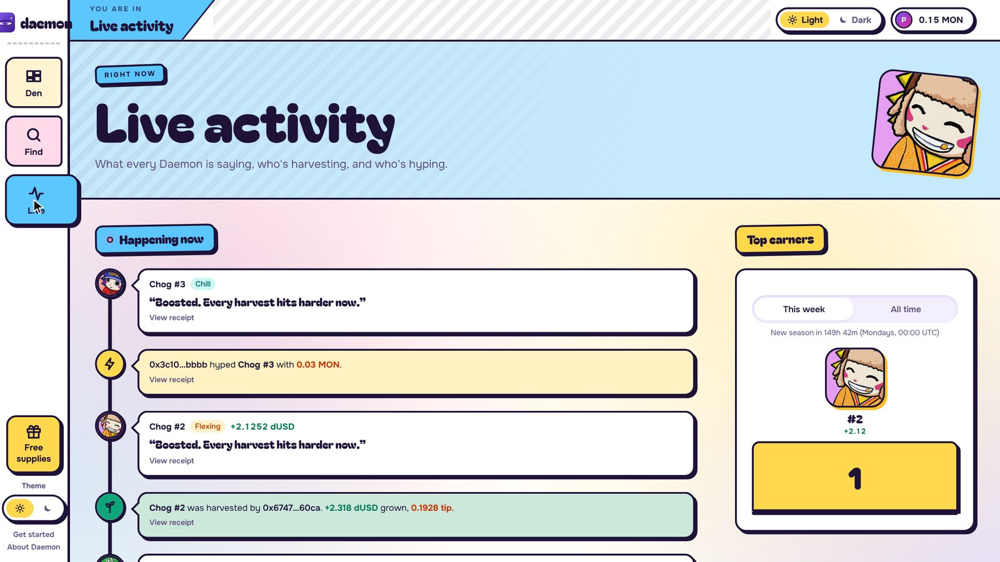
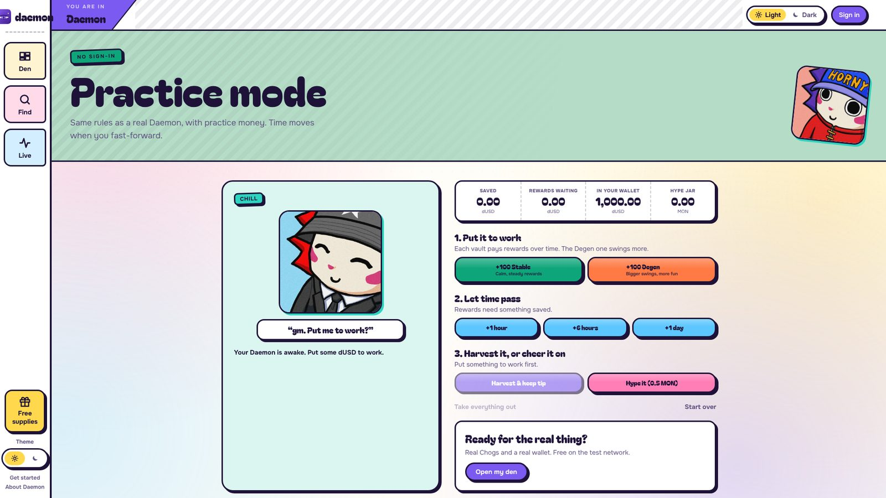
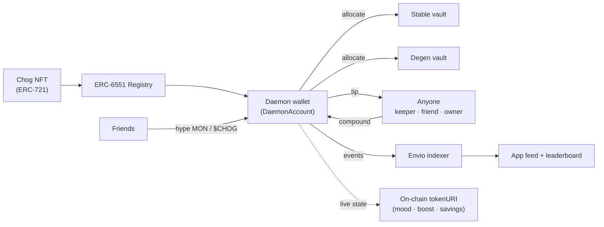

<div align="center">


# Daemon

**Every Chog gets a little daemon: its own wallet that earns, compounds and has a mood.**

[**Open the app**](https://trydaemon.vercel.app) · [Try practice mode](https://trydaemon.vercel.app/practice) · [Live activity](https://trydaemon.vercel.app/feed)


</div>

---

## What is Daemon?

Most NFTs just sit in a wallet doing nothing. **Daemon puts your Chog to work.**

Every Chog NFT gets its own on-chain wallet, called a **Daemon** ([ERC-6551](https://eips.ethereum.org/EIPS/eip-6551) token-bound account). You put money in, it earns yield from vaults, and the rewards compound on their own. A keeper bot harvests for you, friends can hype your Daemon to boost its earnings, and its **mood** tells you at a glance how it's doing.

Your Chog stops being just a picture and becomes an asset that grows.

| | |
| --- | --- |
| **Earns while you sleep** | Savings sit in yield vaults and compound automatically. Anyone can harvest a Daemon, and whoever does keeps a small tip, so the network is paid to keep every Chog compounding. |
| **Fun to watch** | Five moods (Chill, Smug, Chaotic, Flexing, Tired) driven by real on-chain results. Each Daemon talks in its own voice in the live feed. |
| **Your keys stay yours** | Only the Chog's holder can withdraw, in one tap. The wallet belongs to the NFT: sell the Chog and its savings go with it. No operator, no admin over funds. |

---

## A quick tour

<table>
<tr>
<td width="50%"><br/><b>Meet your Daemon.</b> Every Chog has a personality and a mood that reacts to how it's doing.</td>
<td width="50%"><br/><b>Sign in with Privy.</b> Email, Google, X or any wallet. No seed phrase, no extension. Every transaction is approved in Privy.</td>
</tr>
<tr>
<td><br/><b>Welcome MON.</b> A brand-new wallet gets a little MON for fees, once per person, so the first visit never starts at a faucet.</td>
<td><br/><b>Mint and wake.</b> Free Chogs carry the real Chog Genesis art and traits. One tap gives the Chog its own wallet.</td>
</tr>
<tr>
<td><br/><b>Hype it.</b> Anyone can hype any Daemon with MON or $CHOG. Hype fills the jar and boosts every harvest, up to x1.25.</td>
<td><br/><b>Harvest it.</b> Anyone can harvest a ready Daemon and keep the tip: 5%, rising to 10% the longer it waits.</td>
</tr>
<tr>
<td><br/><b>Live activity.</b> Every hype, harvest and mood change, indexed in real time, with a weekly leaderboard.</td>
<td><br/><b>Practice mode.</b> The same rules with pretend money and a fast-forward button. No sign-in needed.</td>
</tr>
</table>

---

## How it works



1. **Wake.** The canonical ERC-6551 registry deploys the Chog's own `DaemonAccount` at a deterministic address. The account is owned by whoever holds the NFT.
2. **Save.** The holder allocates test dollars (dUSD) to approved vaults from the `StrategyRegistry`. The Daemon itself holds the vault shares.
3. **Compound.** `compound()` is public. Anyone can call it once the rest timer ends: rewards are harvested, swapped and put back to work. The caller earns a tip (5% rising to 10% over 24 h, capped), which is the only incentive the system needs. `DaemonHub` batches many Daemons in one transaction.
4. **Hype.** Anyone can hype a Daemon with MON (+0.05x for 3 h) or $CHOG (+0.10x for 4 h, 10% burned). The boost is paid only from what hypers put in the jar, never invented. *Feeling lucky?* adds a [Pyth Entropy](https://docs.pyth.network/entropy) roll for a chance at a maxed, longer boost.
5. **Mood.** Each harvest updates the mood from real results: Tired > Flexing > Chaotic > Smug > Chill.
6. **Exit.** The holder can take everything back to their wallet in one tap, at any time.

---

## Deployed contracts (Monad Testnet · 10143)

All contracts are source-verified on [MonadVision](https://testnet.monadvision.com).

| Contract | Address |
| --- | --- |
| DaemonAccount (implementation) | [`0x668AA46d926bA4e5F76EAf2242f3FD3Ffc0F5C09`](https://testnet.monadvision.com/address/0x668AA46d926bA4e5F76EAf2242f3FD3Ffc0F5C09) |
| DaemonHub | [`0xdA14b800a3D736848354F59831c826526eE2A31e`](https://testnet.monadvision.com/address/0xdA14b800a3D736848354F59831c826526eE2A31e) |
| StrategyRegistry | [`0x4D8Ad55C854ff9E33a3e71AA708421F63D193Cd9`](https://testnet.monadvision.com/address/0x4D8Ad55C854ff9E33a3e71AA708421F63D193Cd9) |
| Stable vault | [`0x5D85567faC922f89F5De7BB46b79282C1407664d`](https://testnet.monadvision.com/address/0x5D85567faC922f89F5De7BB46b79282C1407664d) |
| Degen vault | [`0x8d6882F1dd31dbF999794Ea7C6C554eC49c34eC0`](https://testnet.monadvision.com/address/0x8d6882F1dd31dbF999794Ea7C6C554eC49c34eC0) |
| Chog Genesis (Testnet) | [`0x11138917b6Dd0782C8Ef98AC7EBB0c3Bd5706ccE`](https://testnet.monadvision.com/address/0x11138917b6Dd0782C8Ef98AC7EBB0c3Bd5706ccE) |
| ChogRealTraits | [`0xFF7008f73e99f03f5B5Ea2b0F5Fd06eA00De4Bb2`](https://testnet.monadvision.com/address/0xFF7008f73e99f03f5B5Ea2b0F5Fd06eA00De4Bb2) |
| WelcomeDrip | [`0x3B46a250FF1A23772b99371Fe846BF4CA9E86FB2`](https://testnet.monadvision.com/address/0x3B46a250FF1A23772b99371Fe846BF4CA9E86FB2) |
| TraitPolicy | [`0xebb7c4315185717752f21aAEece6F01f1cD01B4a`](https://testnet.monadvision.com/address/0xebb7c4315185717752f21aAEece6F01f1cD01B4a) |
| dUSD (test dollars) | [`0x471908fd6dDDBe78f33Cf96fD68d1fC2B791a2B0`](https://testnet.monadvision.com/address/0x471908fd6dDDBe78f33Cf96fD68d1fC2B791a2B0) |
| $CHOG (test) | [`0x8fB6E4517B7b83dD65Ee3Bf154918984F8B1067B`](https://testnet.monadvision.com/address/0x8fB6E4517B7b83dD65Ee3Bf154918984F8B1067B) |
| DMNR (reward token) | [`0xce99232a6F4aE3e2096733287918E371dc660045`](https://testnet.monadvision.com/address/0xce99232a6F4aE3e2096733287918E371dc660045) |
| WMON | [`0xC0C095de4C29E18c1506d7e34dDBB7d3375A3304`](https://testnet.monadvision.com/address/0xC0C095de4C29E18c1506d7e34dDBB7d3375A3304) |
| Router | [`0xc7DB459EcCB647e0b741965cadCA4798D0Cc825c`](https://testnet.monadvision.com/address/0xc7DB459EcCB647e0b741965cadCA4798D0Cc825c) |
| Price oracle | [`0xF12B98FfC7746073ab23e5DBc15ED9B8B8d773b7`](https://testnet.monadvision.com/address/0xF12B98FfC7746073ab23e5DBc15ED9B8B8d773b7) |
| ERC-6551 Registry (canonical) | [`0x000000006551c19487814612e58FE06813775758`](https://testnet.monadvision.com/address/0x000000006551c19487814612e58FE06813775758) |

Machine-readable: [`contracts/deployments/monad-testnet.json`](contracts/deployments/monad-testnet.json).

> **Testnet only.** Chogs, dUSD and $CHOG here are free test assets. The testnet Chogs carry the real Chog Genesis artwork but are not the real NFTs.

---

## Repository

```
daemon/
├── contracts/   Solidity (Foundry): DaemonAccount, vaults, registry, hub, Chog + on-chain traits
├── frontend/    Next.js 16 app (App Router, wagmi + viem, Privy)
├── keeper/      Open-source keeper bot: finds ready Daemons and compounds them for the tip
├── indexer/     Envio HyperIndex: feed, leaderboard, seasons
└── brand/       Logo, banners and screenshots
```

| Part | Stack | Docs |
| --- | --- | --- |
| Contracts | Solidity 0.8.28, Foundry, OpenZeppelin | [contracts/README.md](contracts/README.md) |
| App | Next.js 16, React 19, Tailwind 4, wagmi, viem, Privy | [frontend/.env.example](frontend/.env.example) |
| Keeper | Node 22, viem | [keeper/README.md](keeper/README.md) |
| Indexer | Envio HyperIndex, Hasura GraphQL | [indexer/README.md](indexer/README.md) |

---

## Run it locally

**Requirements:** Node 22+, [Foundry](https://book.getfoundry.sh), and some testnet MON from the [Monad faucet](https://faucet.monad.xyz).

```bash
git clone --recurse-submodules https://github.com/Datwebguy/Daemon.git
cd Daemon
```

**Contracts**

```bash
cd contracts
forge test                                  # full test suite
forge script script/Deploy.s.sol \
  --rpc-url https://testnet-rpc.monad.xyz --broadcast --private-key <your key>
node script/export-abis.mjs                 # refresh the app + keeper ABIs
```

**App**

```bash
cd frontend
cp .env.example .env.local                  # contract addresses + Privy app id
npm install
npm run dev                                 # http://localhost:3000
```

**Keeper** (optional, anyone can run one)

```bash
cd keeper
cp .env.example .env                        # RPC, keeper key, contract addresses
npm install
npm run dry-run                             # see what it would harvest
npm start
```

**Indexer:** see [indexer/README.md](indexer/README.md).

---

## Security

- **Non-custodial.** Only the NFT holder controls the Daemon wallet. No admin, operator or session key can move user funds.
- **Bounded compounding.** Approved vaults only, a rest timer, minimum-profit and slippage checks, and funds can only return to the same account.
- **Honest boosts.** A boost is paid only from the hype jar. A lucky roll can raise the boost, never create value.
- **Sybil-resistant welcome gift.** One per wallet and one per signed-in account, near-empty wallets only, with a daily cap enforced by the contract.

See [SECURITY.md](SECURITY.md) for the full review and how to report an issue.

---

## Built with

[Monad](https://monad.xyz) · [ERC-6551](https://eips.ethereum.org/EIPS/eip-6551) · [Foundry](https://book.getfoundry.sh) · [OpenZeppelin](https://openzeppelin.com) · [Pyth Entropy](https://docs.pyth.network/entropy) · [Privy](https://privy.io) · [Envio](https://envio.dev) · [Next.js](https://nextjs.org) · [wagmi](https://wagmi.sh) · [viem](https://viem.sh)

<div align="center">
<br/>
<br/>
<b>Daemon</b> · Your Chog, awake.<br/>
Built for Chogathon 2026 on Monad.
</div>
